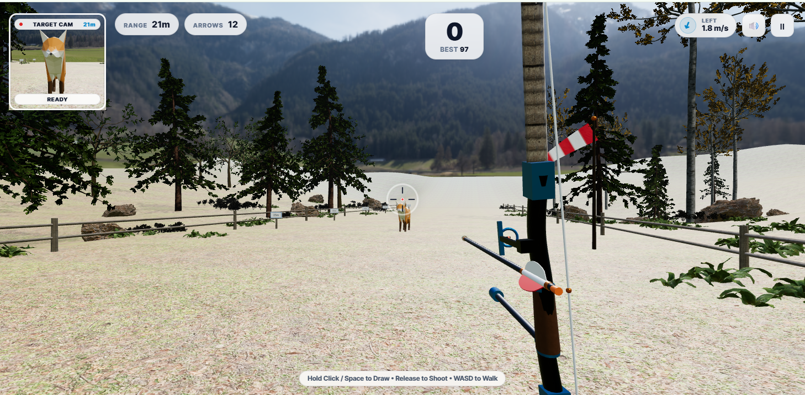

# Archery 3D

A modular, Three.js 3D alpine archery game featuring realistic ballistic physics, crosswind drift, dynamic Olympic range distances, procedural Web Audio synthesis, a crisp daylight light-theme UI, and headless unit tests.



## Highlights

- **Photorealistic 3D Alpine Landscape (Three.js)**
  - Real 360° Alps mountain & cloud HDRI panorama (`alps_field_2k.hdr`, CC0 via Poly Haven) driving both the skybox and physically based IBL reflections.
  - Genuine 3D multi-branching trees via `@dgreenheck/ez-tree` with textured bark and 3D leaf canopies, plus CC0 3D photogrammetry GLTF models (`fern_02`, `wild_rooibos_bush`, `boulder_01`) scattered along the seamless 1K PBR photographic grass meadow.
  - Textured woven-cloth Olympic wind pennant with metallic grommets and dual-harmonic cloth flutter, plus PBR-textured recurve bow (brushed metal riser, stitched leather grip, laminated wood limbs).
- **Walkable Shooting Box & Live Target Spotting Cam**
  - Walk freely inside the marked `13m × 8m` archer's shooting box (`WASD` / Arrow keys) to adjust shooting angles and range distance dynamically.
  - Real-time top-left **Target Spotting Camera** (hardware-rendered 3D PiP viewport) zooms in on the Olympic target face so you can see exactly where every arrow lands up close.
- **Tactile 3D Draw & Ballistics**
  - First-person recurve bow with flexing limbs, dynamic bowstring tension, subtle camera FOV zoom while drawing, breathing sway, and fatigue tremor if held too long at full draw.
  - Real 3D gravity drop (`-9.81 m/s²`), lateral & vertical wind drift, arrow pitch/yaw velocity alignment, and Z-plane segment intersection to prevent high-speed tunneling.
- **3 Distinct Game Modes**
  - **Championship**: 12 arrows across escalating 25m–65m targets with moving rails unlocked at higher stages; bullseyes grant `+2` bonus arrows.
  - **Time Attack**: 60-second rapid-fire sprint on a moving 35m target with unlimited arrows and streak multipliers.
  - **Wind Master**: Long-range 55m–75m moving targets, strong alpine crosswinds, tighter competition target face, and `2x` score multiplier.
- **Olympic Daylight Light-Theme UI/UX**
  - Frosted light-glass HUD pills, live rotating Wind Compass (`m/s`), SVG circular draw-tension reticle, world-to-screen projected floating score popups, and detailed post-round analytics (Score, Best, Accuracy, Avg Ring, Bullseyes, Longest Streak).
- **Zero-Dependency Procedural Audio & Headless Testing**
  - Web Audio API synthesizer generates bow twang, arrow whoosh, target thud, bullseye chimes, and high-score fanfare with zero external audio assets.
  - Pure 3D simulation (`GameEngine`, `Arrow`, `Target`) is completely decoupled from Three.js & DOM so the full unit test suite runs headlessly in Node.js (`npm test`).

## Architecture

```text
├── index.html                      # Three.js import map, light-theme HUD & modal overlays
├── styles/
│   └── main.css                    # Daylight light-theme design tokens & responsive layout
├── src/
│   ├── main.js                     # Composition root & application bootstrap
│   ├── config/
│   │   └── constants.js            # 3D ballistics, modes, Olympic 10-ring scoring config
│   ├── core/
│   │   ├── EventBus.js             # Decoupled pub/sub event bus
│   │   ├── GameEngine.js           # 3D state machine, draw/release & ballistic loop
│   │   └── StorageService.js       # Safe localStorage persistence with memory fallback
│   ├── entities/
│   │   ├── Arrow.js                # 3D projectile kinematics & Z-plane intersection
│   │   └── Target.js               # 3D radial Olympic ring scoring & rail movement
│   ├── scene/
│   │   ├── LandscapeBuilder.js     # Procedural alpine terrain, mountains, forest, clouds & wind flag
│   │   ├── ModelFactory.js         # Procedural 3D recurve bow, arrows & Olympic target stand
│   │   └── SceneRenderer.js        # WebGLRenderer, lighting, shadows, camera zoom & 3D particles
│   ├── systems/
│   │   ├── AudioEngine.js          # Procedural Web Audio API sound synthesizer
│   │   └── InputManager.js         # Smooth 3D pointer aim, hold-to-draw & keyboard controls
│   └── ui/
│       └── UIController.js         # Light-glass HUD, wind compass, reticle & world popups
├── tests/                          # Node.js built-in test runner unit tests
├── scripts/
│   └── dev-server.mjs              # Zero-dependency local static server
└── .github/workflows/ci.yml        # GitHub Actions CI workflow
```

## Controls

| Input                             | Action                   |
| --------------------------------- | ------------------------ |
| `Mouse Move` / `Touch Drag`       | Aim across the 3D range  |
| `Hold Click` / `Hold Space`       | Draw bowstring & zoom in |
| `Release Click` / `Release Space` | Fire arrow               |
| `P` / `Esc`                       | Pause / Resume           |
| `M`                               | Mute / Unmute audio      |

## Getting Started

Requires **Node.js 20+** (zero `npm install` required; Three.js loads via standard browser ES Import Maps).

```bash
# Start the local development server (http://localhost:3000)
npm run dev

# Run the headless 3D physics & engine unit tests
npm test
```

Because the project uses standard ES Modules and Import Maps with no build step, it deploys directly to **GitHub Pages**, **Netlify**, or **Vercel** from the repository root.

## License

MIT — see [LICENSE](./LICENSE).
